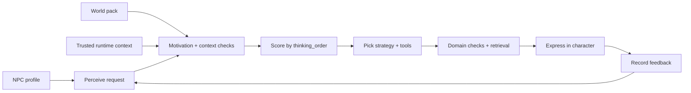

# External NPC profiles, unique cognition chains, and world packs

Version: 0.4.0. 中文：[NPC_COGNITION.md](NPC_COGNITION.md)

NPC **profiles** supply identity and a per-character thinking order. **World packs** supply the game setting (King’s Canyon–style lanes, Teyvat-style continents, blocky villages, open-world borders). **Providers** supply the chat model. The **cognitive engine is not replaced** when you reskin the world or swap models—each NPC keeps its own decision chain.

## Pipeline



Six stages every turn: **perception → motivation → context → selection → expression → feedback**.

Scores are application heuristics, not model confidence. `last_decision` is an auditable program summary—not a transcript of hidden LLM chain-of-thought. That is intentional: the “real” chain is the deterministic policy owned by this NPC.

## Why chains stay unique

1. `thinking_order` — a permutation of caution / empathy / duty / curiosity that affects scoring bonuses.  
2. `decision_style` weights plus goals, values, and profession bias.  
3. Trusted context (danger, time of day, relationship, nearby events).

World packs change lore retrieval and setting name. They do **not** reset or share one global thinking order across NPCs.

## World packs for specific games

| Intent | World id | Example NPC |
| --- | --- | --- |
| Honor of Kings–style MOBA map | `honor_of_kings` | Lane minion |
| Genshin Impact–style open world | `genshin` | Street vendor |
| Minecraft-style sandbox village | `minecraft` | Village trader |
| Open world / Dead Champion–like borders | `open_world` | Caravan broker |

Bundled text is an **original demo skeleton**, not official copy. Put authorized or original lore in `knowledge/`, then `ingest`. The runtime **does not scrape websites**; hosts may download and review pages offline, then import files.

```bash
game-npc --world-pack src/game_npc/assets/worlds/genshin --use-world-npc \
  --state-dir .runtime chat "Who are you?" --explain
```

```python
from game_npc.bootstrap import build_conversation, open_builtin_world
from game_npc.config import Settings
from game_npc.world import load_world_npc

pack, pack_dir = open_builtin_world("genshin")
conversation = build_conversation(
    Settings(mode="live", provider="openai", api_key="..."),
    profile=load_world_npc(pack_dir, pack.default_npc),
    world=pack,
)
print(conversation.reply("Any supplies for the road?"))
print(conversation.last_decision["thinking_order"])
```

## Profile and context rules

- Required profile fields: `npc_id`, `name`, `personality`, `profession`, `region`.  
- Profiles cannot add tools or weaken domain checks.  
- Runtime context comes only from the trusted host; player chat cannot rewrite danger, relationship, or quest progress.  
- Report mode is read-only at the tool layer.

## Boundaries

No public HTTP API or engine plugin in this release. Demo SQLite is not a production game backend. Swapping worlds or models must never bypass reward validation.
