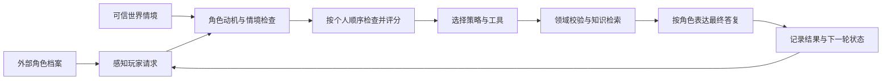

# 可外部设定的 NPC 与角色决策流程

版本：0.3.0。姓名、性格、职业、区域、目标、价值偏好、表达习惯、检查顺序和策略权重都由角色档案输入。角色切换以完整档案指纹为边界，NPC 与玩家身份分别存储。

## 完整流程与角色差异



每轮记录六个阶段：**感知 → 动机 → 情境与关系 → 行为选择 → 表达 → 反馈**。程序生成的短摘要包含意图、目标、检查顺序、候选分数、规则、工具结果及来源。分数是应用启发式，不是模型置信度；摘要不是模型隐藏推理的逐字记录。

角色的独特性有三个来源：

1. `thinking_order` 决定先关注什么，顺序实际参与评分。
2. 四项权重、职业、目标及价值排序共同影响策略；职业只提供初始倾向，不锁死行为。
3. 外部危险度、昼夜、关系和附近事件影响当前选择；在线模型依据角色资料与计划组织最终语言。

同一句“我想去城外冒险，有什么建议？”，默认情境下的实际选择：

| NPC | 个人检查顺序 | 默认策略 | 行为重点 |
| --- | --- | --- | --- |
| 林守溪 · 村长 | 共情 → 职责 → 警戒 → 好奇 | 耐心引导 `guide` | 安顿需求，给出能落实的一步 |
| 沈砺 · 北门守卫队长 | 警戒 → 职责 → 共情 → 好奇 | 风险防护 `protect` | 核实安全与条件，再提出建议 |
| 苏锦禾 · 集市杂货商 | 好奇 → 共情 → 职责 → 警戒 | 先行询问 `inquire` | 确认实际需求，再给出可靠选择 |

危险度升高时，村长也会从引导转为防护。合法交付与领奖始终由领域规则校验，不因角色大胆或关系良好就放宽。报告模式只读在工具层强制执行。

## 外部角色 JSON

```json
{
  "npc_id": "north_gate_guard",
  "name": "沈砺",
  "personality": ["克制", "警觉", "按章办事"],
  "profession": "北门守卫队长",
  "region": "溪谷村·北门哨所",
  "background": "长期值勤，习惯核实事实后作判断。",
  "speech_style": "简短、直接，使用已确认的信息和明确条件回应。",
  "goals": ["确保北门安全", "按规则处理任务交付", "保护通行者"],
  "values": ["秩序", "职责", "安全"],
  "thinking_order": ["caution", "duty", "empathy", "curiosity"],
  "decision_style": {"caution": 95, "empathy": 35, "duty": 100, "curiosity": 15}
}
```

必需字段为 `npc_id/name/personality/profession/region`，其余有默认值。四个维度分别为警戒、共情、职责和好奇，权重是 0–100 的整数。`thinking_order` 必须为四维完整、不重复排列；旧档案没有此字段时采用默认顺序。

文件上限 64 KB；拒绝未知字段、错误类型、重复 JSON 字段和 NaN。标识和姓名最多 64 字符，职业与区域最多 128 字，背景最多 2000 字。性格、目标、价值列表各最多 16 项。档案不能新增工具或修改系统权限。

## 实时世界情境

```json
{
  "region": "黑松林·外侧哨所",
  "time_of_day": "night",
  "nearby_events": ["哨所正在核实一份道路异常报告"],
  "relationship": -20,
  "danger": 70
}
```

区域覆盖本轮 NPC 的位置，不覆盖玩家位置；不传则采用档案区域。时段为 `dawn/day/dusk/night`，关系 -100 到 100，危险度 0 到 100。附近事件最多 16 条，每条最多 200 字。

世界情境来自可信游戏宿主，玩家聊天不能直接修改它。模型没有改变关系、危险度和进度的工具。当前关系不自动增长，长期事件记忆和关系学习尚未实现。

## CLI 与界面

```bash
# 输出可编辑样例，无需密钥
game-npc npc --sample guard > guard.json

# 使用外部档案，并输出结构化决策摘要
game-npc --npc-profile guard.json --state-dir .runtime chat "我想去城外冒险，有什么建议？" --explain

# 终端交互每轮重新读取可信情境文件
game-npc --npc-profile guard.json --state-dir .runtime chat --context-file examples/world_context.json --explain
```

`GAME_NPC_PROFILE_PATH` 也可指定角色文件，CLI 参数优先。角色档案在会话创建时读取；变更后重开会话，或由宿主调用 `set_profile()`。实时情境文件在终端交互中每轮刷新。

界面左侧可选择内置角色、编辑并应用角色 JSON、模拟实时情境。不同档案清空旧角色聊天、资料和摘要，保留玩家资产；改变实时情境保留同一角色的对话。主界面分别显示当前 NPC 与玩家任务，答复下方可展开角色决策摘要。

## Python / 游戏宿主接入

```python
from pathlib import Path
from game_npc.bootstrap import build_conversation
from game_npc.config import Settings
from game_npc.persona import load_profile

conversation = build_conversation(
    Settings(mode="demo", state_dir=Path(".runtime")),
    player_id="1001",
    profile=load_profile("guard.json").to_dict(),
    context={"region": "北门哨所", "danger": 20, "relationship": 0},
)
answer = conversation.reply(
    "我想去城外冒险，有什么建议？",
    context={"region": "黑松林入口", "danger": 85, "time_of_day": "night"},
)
packet = {
    "npc_id": conversation.profile.npc_id,
    "answer": answer,
    "decision": conversation.last_decision,
}
```

`profile/context` 分别接受已验证对象或字典，不必从文件读取。`set_profile()` 检查完整指纹，相同档案保留聊天；任何字段变化都清空旧角色聊天和情境，宿主应再传入该 NPC 与玩家的最新情境。`set_context()` 不清空聊天。单个 Conversation 对应一组 NPC / 玩家串行会话，不应在多个玩家或并发请求间共用。

`last_tool_outcomes` 区分成功、错误与预算拒绝。如果工具已执行而模型随后失败，摘要为 `status="failed"`，并标记 `partial_operations=true`，不会伪称撤销已发放的奖励。宿主应核对游戏状态后处理重试。

本次提供 JSON 与 Python 接口，没有新增公开 HTTP 服务、Unity/Unreal 插件或真实游戏登录。真实接入仍需替换演示领域服务，并由服务器认证玩家与事件。

## 验证

macOS / Python 3.12 下 141 项测试通过，包括角色格式校验、检查顺序实际评分、三角色差异、动态区域与危险度、身份与玩家隔离、角色切换、失败部分成功记录，以及 4 项 Streamlit 界面回归。Python 3.14 下 136 项核心测试通过，5 项可选 UI / Chroma 测试跳过。

已构建 0.3.0 的 wheel / sdist；3 份角色模板随 wheel 分发。在源码目录外的干净 wheel 环境中，外部角色 JSON、外部世界情境、六阶段计划与演示回复均验证通过。Ruff、pip check 和锁文件一致性检查通过，本机界面也已启动并查看。

在线角色表达仍需真实模型单独验收；离线演示验证程序策略、角色配置和工具边界。本轮未推送 GitHub，未运行远端 CI。
