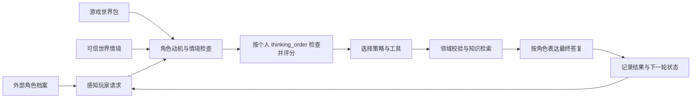

# 可外部设定的 NPC、独特思维链与游戏世界包

版本：0.4.0。English: [NPC_COGNITION.en.md](NPC_COGNITION.en.md)

姓名、性格、职业、区域、目标、价值偏好、表达习惯、检查顺序和策略权重由**角色档案**输入。王者峡谷、提瓦特、方块世界、大世界等由**世界包**输入。聊天模型可换提供商。**认知引擎本身不随换皮替换**——每个 NPC 形成并保留自己的思维链。

## 完整流程



每轮六个阶段：**感知 → 动机 → 情境与关系 → 行为选择 → 表达 → 反馈**。

分数是应用启发式，不是模型置信度；`last_decision` 是可审计的程序摘要，不是模型隐藏 CoT 的逐字记录。这正是“真实思维链”的含义：决策由本 NPC 的 `thinking_order` 与权重确定性算出，模型只负责在约束下表达。

## 独特思维链从何而来

1. `thinking_order`：四维（警戒 / 共情 / 职责 / 好奇）的完整排列，顺序参与评分加成。
2. `decision_style` 权重 + 目标 / 价值 / 职业倾向。
3. 可信情境（危险度、昼夜、关系、附近事件）调节当前选择。

同句「我想去城外冒险」：

| NPC | 检查顺序 | 默认策略 |
| --- | --- | --- |
| 林守溪 · 村长 | 共情 → 职责 → 警戒 → 好奇 | `guide` |
| 沈砺 · 守卫 | 警戒 → 职责 → 共情 → 好奇 | `protect` |
| 苏锦禾 · 商人 | 好奇 → 共情 → 职责 → 警戒 | `inquire` |
| 中路小兵（王者包） | 职责 → 警戒 → … | 偏防护 / 职责 |
| 街头商贩（原神包） | 好奇 → 共情 → … | 偏询问 |

危险度升高时，共情型也会转向防护。合法交付与领奖始终由领域规则校验。

## 游戏世界包（背景外接）

适用于：

- **王者荣耀风格**：设定「王者峡谷」类地图，NPC 为小兵或英雄口吻角色  
- **Genshin Impact 风格**：设定「提瓦特」类大陆，NPC 为商贩等  
- **Minecraft 风格**：方块村庄，村民 / 商人  
- **大世界 / Dead Champion 类**：边境驿站与开放世界；宿主整理网页或文档后导入知识库  

```json
{
  "world_id": "genshin",
  "title": "原神风格开放世界（演示框）",
  "setting_name": "提瓦特大陆风格开放世界",
  "summary": "……",
  "regions": ["蒙德城门口", "璃月港码头"],
  "knowledge_dir": "knowledge",
  "default_npc": "street_vendor"
}
```

世界包只提供设定框与知识路径；**不会**改写 `CognitiveEngine`。正式 IP 内容须宿主自行提供授权或原创资料。运行时**不自动搜索或爬取网页**。

```bash
game-npc world --list
game-npc --world-pack path/to/pack --use-world-npc --state-dir .runtime chat "你好" --explain
```

Python：

```python
from game_npc.bootstrap import build_conversation, open_builtin_world
from game_npc.config import Settings
from game_npc.world import load_world_npc

pack, pack_dir = open_builtin_world("honor_of_kings")
profile = load_world_npc(pack_dir, pack.default_npc)
conversation = build_conversation(
    Settings(mode="demo", state_dir=".runtime"),
    profile=profile,
    world=pack,
    context={"region": "中路河道", "danger": 40},
)
answer = conversation.reply("前方安全吗？")
packet = {"answer": answer, "decision": conversation.last_decision}
```

## 外部角色 JSON

必需：`npc_id/name/personality/profession/region`。`thinking_order` 必须为四维完整不重复排列。档案不能新增工具或修改系统权限。文件上限 64 KB。

## 实时情境

由可信游戏宿主提供：`region`、`time_of_day`、`nearby_events`、`relationship`、`danger`。玩家聊天不能直接修改。关系长期学习尚未实现。

## 边界

- 无公开 HTTP / 引擎插件；宿主用 Python API 或 CLI 接入。  
- 演示 SQLite 不是真实登录与玩法服务器。  
- 换世界 / 换模型都不许绕过任务校验与只读报告模式。  
